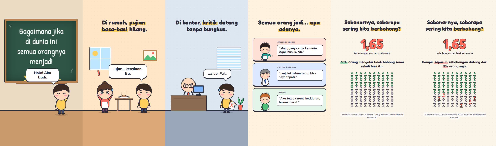
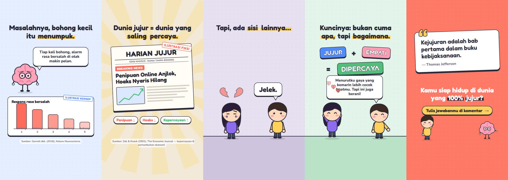

# 2d-motion

An agent skill that makes vertical **2D chibi explainer videos** for Reels / TikTok / Shorts — flat cartoon
characters with ink outlines, word-by-word captions, speech bubbles, springy motion, a narrator voice, sound effects
and music — the same way every time, on any agent harness.

| | |
|---|---|
|  |  |

**Stack:** [Remotion](https://www.remotion.dev) (picture) · Gemini TTS `gemini-3.8-flash-tts`, voice *Rami*,
temperature 0 (narration) · [earshot](https://github.com/Leonxlnx/earshot) sound bank (SFX + music made in code) ·
a deterministic Python mixer (ducking, -14 LUFS master).

## Why results stay the same across agents

1. **The style is code.** Characters, palette, fonts, captions, bubbles, springs and transitions live in the
   template's `src/lib/`; agents compose scenes from them instead of re-inventing them.
2. **Everything else is data.** Script (`audio/voiceover.json`), timing (`src/timing.json` + `src/beats.json` from
   the real voice), sound effects (`audio/sfx-cues.json`) and music (`audio/music.json`); scripts turn them into
   picture and sound deterministically.
3. **One QA checklist** on rendered stills and measured audio before delivery.

## Install

```bash
git clone https://github.com/widisaadi/2d-motion.git
cd 2d-motion
./install.sh                 # macOS / Linux / Git Bash
.\install.ps1                # Windows PowerShell
```

It copies `skills/2d-motion` to every harness it finds: Claude Code (`~/.claude/skills`), Codex (`~/.codex/skills`),
Antigravity (`~/.gemini/config/skills`) and Gemini CLI (`~/.gemini/skills`). Name harnesses to force them:
`./install.sh codex antigravity`. Any other agent: point it at [`AGENTS.md`](AGENTS.md).

Requirements: Node 18+, ffmpeg on PATH, Python 3.10-3.12 for earshot, a Gemini API key.
One-time earshot setup: [`references/audio.md`](skills/2d-motion/references/audio.md#earshot-sound-bank--mixer-dependencies).

## Use

Ask your agent, for example:

> Buatkan video animasi Reels pakai style 2d-motion, judulnya "Bagaimana jika semua orang bisa membaca pikiran?"

The agent copies the template, writes the script and storyboard, generates the voice, times every animation to the
spoken phrases, builds the scenes, checks rendered stills, builds the soundtrack and renders `out/video.mp4`.

Manual pipeline inside a project:

```bash
node <skill>/scripts/new-project.mjs my-video && cd my-video && npm install
npm run tts && npm run verify-vo && npm run beats -- --apply   # voice first, timing from the voice
npm run typecheck && npm run stills                              # scenes + visual QA sheet
npm run audio && npm run render                                  # soundtrack + MP4
```

## Layout

```
skills/2d-motion/
  SKILL.md                 workflow (start here)
  references/              storytelling, style guide, scene cookbook, audio, QA checklist, harness notes
  scripts/new-project.mjs  copies the template
  template/                the Remotion project (reference video included as the example scenes)
  examples/jujur-reels/    contact sheets + notes of the reference video
```

## Notes

- Never commit `.env`; the template ignores it. Keys live only there.
- earshot is MIT-licensed by its author and is installed separately (not vendored here).
- The sounds are synthesized by code, not recordings; levels are measured, not listened to — have a human listen
  before publishing.
